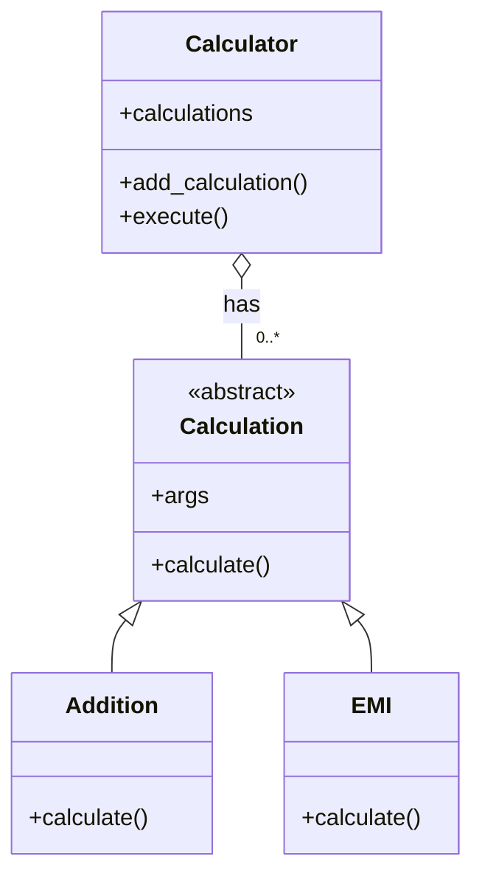

# Calculator – Object-Oriented Design

## 1. Overview

This project demonstrates fundamental Object-Oriented Programming (OOP) concepts using a simple Calculator application.

The application supports different types of calculations, such as:
- Addition
- EMI (Equated Monthly Instalment)

The design uses abstraction, inheritance, polymorphism, and aggregation.

## 2. Object-Oriented Design

### Core Objects

**1. Calculation (Abstract Class)**

Represents a generic calculation.

- **Contents:** `args`
- **Capability:** `calculate()`

**2. Addition (Calculation)**

Represents an addition operation.

- Inherits from `Calculation`.
- Implements the `calculate()` method.
- Accepts numbers as arguments.
- Returns their sum.

**3. EMI (Calculation)**

Represents an EMI calculation.

- Inherits from `Calculation`.
- Implements the `calculate()` method.
- Accepts principal, interest rate, and loan duration.
- Returns the monthly EMI.

**4. Calculator**

Represents the calculator that manages different calculations.

- **Contents:** Collection of calculations.
- **Capabilities:**
  - `add_calculation()`
  - `execute()`

## 3. UML Class Diagram

## 4. Relationships

| Relationship | Objects | Description |
|---|---|---|
| Inheritance (is-a) | Addition → Calculation | Addition is a Calculation. |
| Inheritance (is-a) | EMI → Calculation | EMI is a Calculation. |
| Aggregation (has-a) | Calculator → Calculation | Calculator has multiple Calculations. |

## 5. OOP Concepts Demonstrated

| OOP Concept | Implementation |
|---|---|
| Abstraction | Calculation is an abstract class. |
| Inheritance | Addition and EMI inherit from Calculation. |
| Polymorphism | Each calculation implements its own `calculate()` method. |
| Aggregation | Calculator maintains a collection of Calculation objects. |

## 6. Execution Flow

1. Create a Calculator object.
2. Create an Addition or EMI object.
3. Pass the required arguments to the calculation.
4. Add the calculation object to the Calculator.
5. Invoke `execute()`.
6. Calculator iterates through its calculations and invokes `calculate()` on each object.

## 7. Key Design Principle

The Calculator does not need to know the internal implementation of individual calculations.

It only knows that every Calculation provides a `calculate()` method.

This allows us to introduce new calculation types in the future without modifying the existing Calculator implementation.

For example:
- Subtraction
- Multiplication
- Division
- Simple Interest
- Compound Interest
- Loan Amortization

**The design follows the Open/Closed Principle (OCP): Open for extension, closed for modification.**